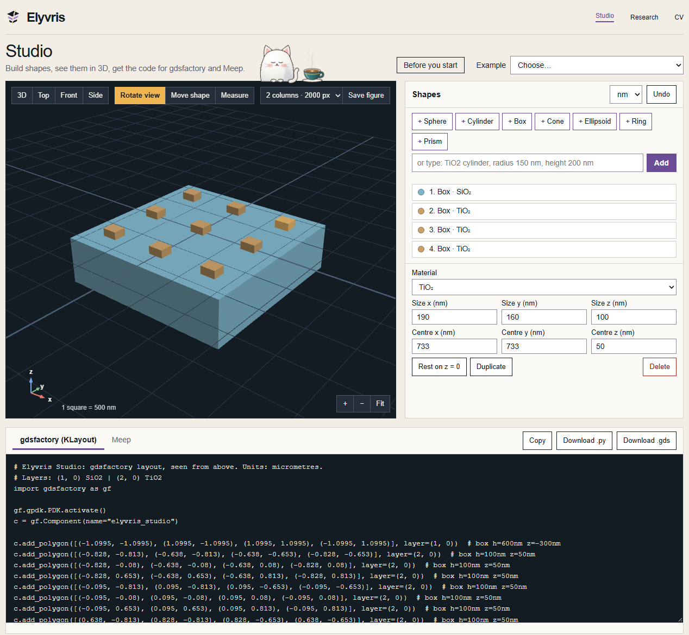

# Elyvris

**Light, unfolded.** Free browser tools for computational photonics.

**Website:** [diogo-poeta.github.io/elyvris](https://diogo-poeta.github.io/elyvris/)

## Studio

[Studio](https://diogo-poeta.github.io/elyvris/studio.html) turns 3D shapes into a [gdsfactory](https://github.com/gdsfactory/gdsfactory) layout script, a GDS file and a [Meep](https://github.com/NanoComp/meep) geometry list, and draws pasted code. It runs in the browser; nothing is uploaded. It draws; it does not simulate.

## Research

Articles and theses, readable on the [research page](https://diogo-poeta.github.io/elyvris/research.html).

| Year | Work | Links |
| --- | --- | --- |
| 2021 | *Extraordinary transparency in continuous metallic thin films.* MSc thesis, University of Minho | [Thesis](https://zenodo.org/records/6346240) |
| 2024 | *Optical anapoles excited by UV-A illumination.* Optics Letters 49, 7198 | [Paper](https://doi.org/10.1364/OL.536925) · [Supplement](https://doi.org/10.6084/m9.figshare.27648525.v5) |
| 2025 | *Volatile organic compound photoionization utilizing tunable quasi-monochromatic vacuum ultraviolet down to 120 nm obtained by third harmonic generation from a suspended dielectric nanomembrane.* Optics Express 33, 26342 (co-author) | [Paper](https://doi.org/10.1364/OE.564577) |
| 2026 | *Real-time molecular specific BTEX detection at TLV-TWA concentration levels.* Environmental Technology & Innovation 42, 104895 (co-author) | [Paper](https://doi.org/10.1016/j.eti.2026.104895) |
| 2026 | *Energy velocity as an optical design indicator for the ultraviolet nonlinear response of ALD-grown TiO₂ thin films.* Optical Materials Express 16, 3342 | [Paper](https://doi.org/10.1364/OME.611814) · [Supplement](https://doi.org/10.6084/m9.figshare.33781774.v2) |
| 2026 | *Tunable VUV photoionization and slow-light enhanced third-harmonic generation in TiO₂ for selective VOC sensing.* PhD thesis, Bielefeld University | [Thesis](https://doi.org/10.4119/unibi/3020621) |

## Contributing

See [CONTRIBUTING.md](CONTRIBUTING.md). Good places to start: [`good first issue`](https://github.com/diogo-poeta/elyvris/labels/good%20first%20issue).

## Licence

- **Code:** [MIT](LICENSE).
- **Text and figures by Diogo Poeta:** [CC BY 4.0](https://creativecommons.org/licenses/by/4.0/).
- **Not covered:** PDFs and `website/documents/` (publishers' or authors' terms); the Elyvris name and logo (`website/favicon.svg`, `website/assets/brand/`, `website/assets/app/`), all rights reserved.

## Citing

> Poeta, D. (2026). *Elyvris Studio* (Version 0.1.0) [Computer software]. Zenodo. https://doi.org/10.5281/zenodo.24310867

## Contact

Diogo Poeta · [LinkedIn](https://pt.linkedin.com/in/diogo-poeta) · [Google Scholar](https://scholar.google.com/citations?user=9GATdmUAAAAJ) · [ORCID](https://orcid.org/0009-0002-1451-5147)

This project is made with the assistance of artificial intelligence.
